# Legacy Authentication Block Policy Showed "On" but Enforced Nothing

## 1. Executive Summary

A security rule meant to block outdated sign-in methods was switched on in the lab tenant for 64 days but was not protecting anything. These older sign-in methods can't use multifactor authentication, which makes them a favorite route for attackers guessing passwords. The rule looked correct on the dashboard, but a review of its settings showed it had never been pointed at any applications, so it skipped every sign-in. The problem was actually visible in a screenshot taken the day the rule was built, but it was misread at the time. It was caught in a later configuration audit, confirmed in the sign-in logs, fixed, tested in a safe monitoring mode, and then turned back on with proof that it now works.

---

## 2. Finding Details

| Field | Value |
|---|---|
| **Finding Title** | Legacy Authentication Block Policy Showed "On" but Enforced Nothing |
| **Finding Type** | Policy Gap |
| **Date Identified** | 2026-11-03 |
| **Environment / Tool** | Microsoft Entra ID, Conditional Access (tenant: iampamprointheknow42gmail.onmicrosoft.com) |
| **Risk Rating** | High |
| **Affected System(s)** | CA03 - Block Legacy Authentication |
| **Affected Account(s)** | All users in scope of CA03 (all users except the two break-glass accounts) |
| **Exposure Window** | 2026-08-31 to 2026-11-03 (64 days) |

---

## 3. Technical Description

### Lab context

`CA03 - Block Legacy Authentication` is intended to block sign-ins from clients that use basic authentication: Exchange ActiveSync, POP, IMAP, SMTP AUTH, and older Office clients. These protocols send a username and password with no MFA step, so they are the standard path for password spray and credential stuffing attacks against Microsoft 365 tenants.

The audit took place on 2026-11-03, after the tenant's Entra ID P1 license was restored and a native cloud administrator account (`mtully.admin`) was created. Before any new policy work, each existing Conditional Access policy was inventoried.

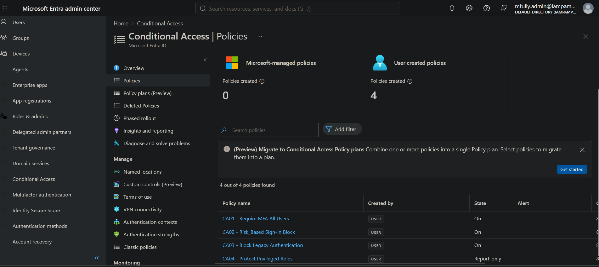

*00-1: Policy inventory before the audit. CA03 reports a state of On.*

### What was observed

Each configuration tab of CA03 was opened and compared against the intended design, without saving any changes. Five of the six settings matched:

| Setting | Intended | Observed | Result |
|---|---|---|---|
| Users: Include | All users | All users | Correct |
| Users: Exclude | Both break-glass accounts only | BreakGlass-Emergency_Access-01, BreakGlass-Emergency_Access-02 | Correct |
| **Target resources** | **All resources** | **None** | **Defect** |
| Conditions: Client apps | Exchange ActiveSync, Other clients | Exchange ActiveSync, Other clients | Correct |
| Grant | Block access | Block access | Correct |
| State | On | On | Correct |

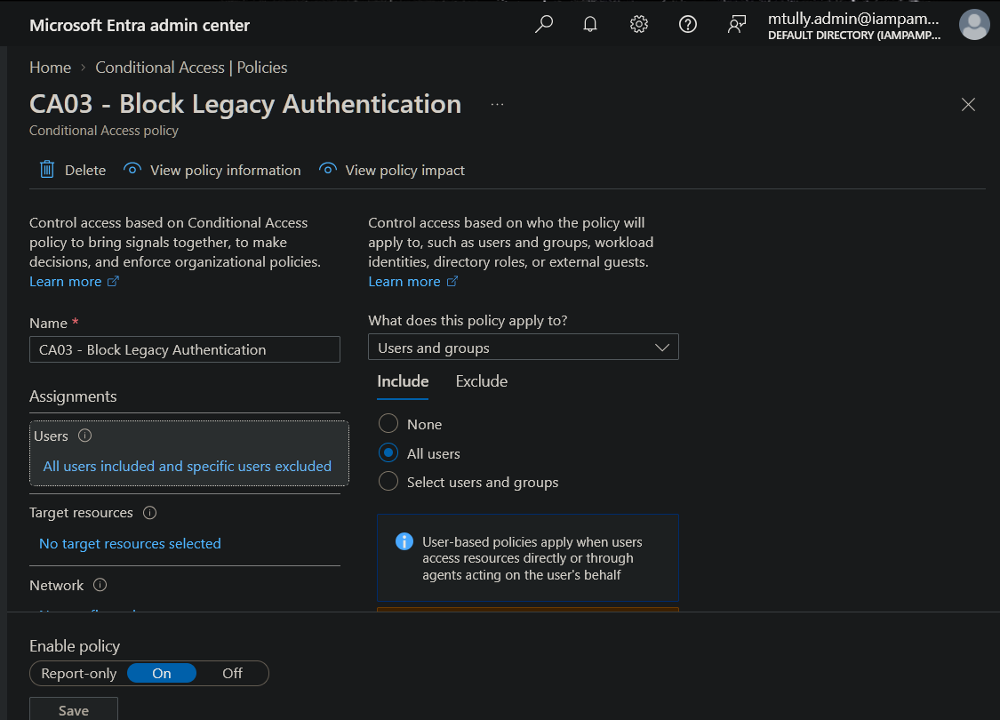

*01-1: Include is set to All users.*

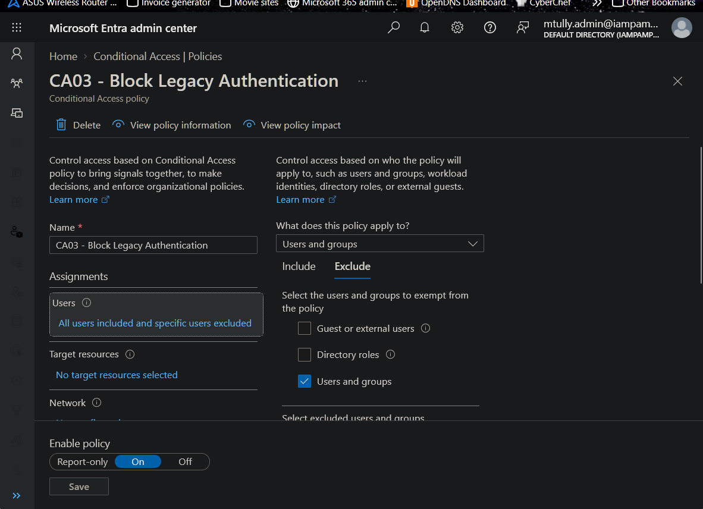

*01-2: Exclude is set to specific users and groups.*

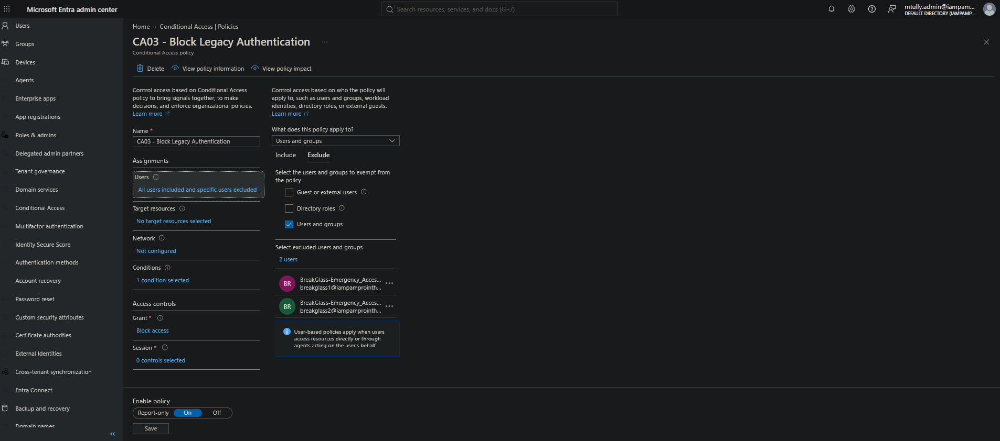

*01-4: The only exclusions are the two break-glass accounts. No standing admin exemption.*

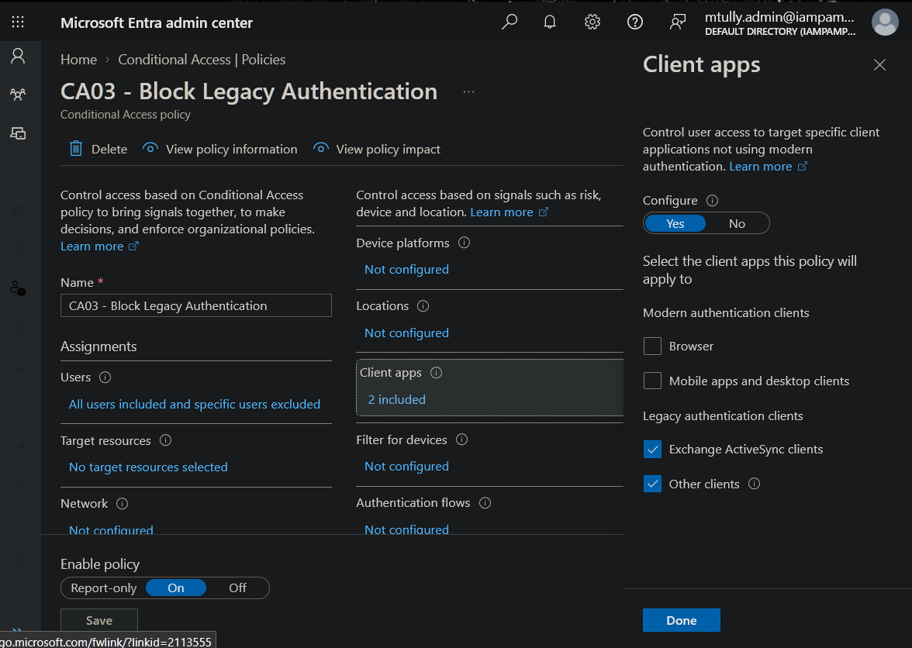

*02-1: Client apps condition targets only Exchange ActiveSync and Other clients, the two legacy categories.*

The defect was in Target resources:

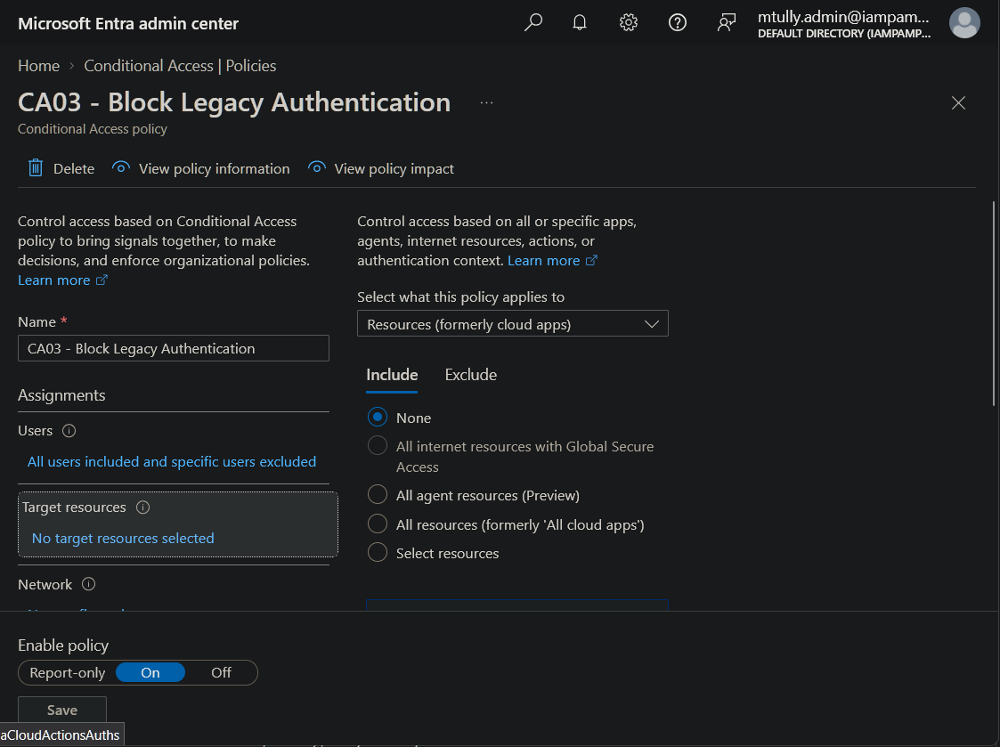

*01-3: **Finding.** Target resources Include is set to None.*

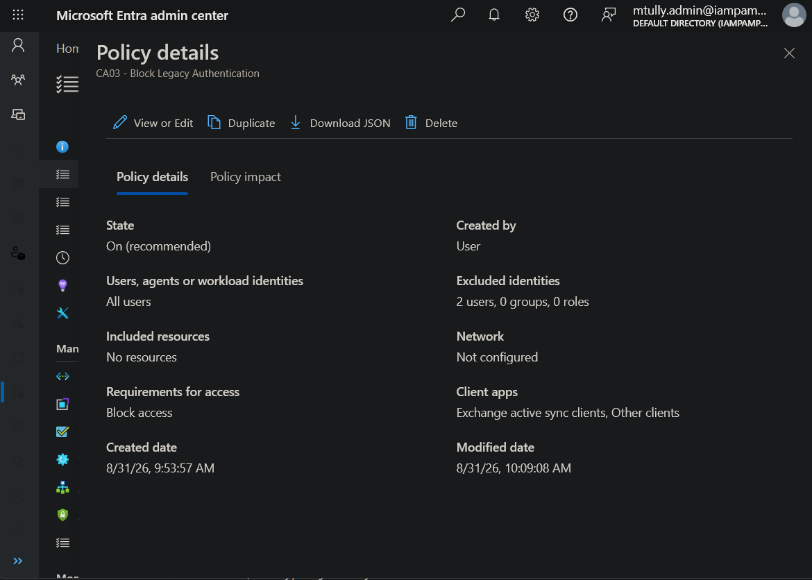

*03-1: Policy summary confirms "Included resources: No resources" while the state reads "On (recommended)." Created 8/31/26 9:53 AM, last modified 8/31/26 10:09 AM.*

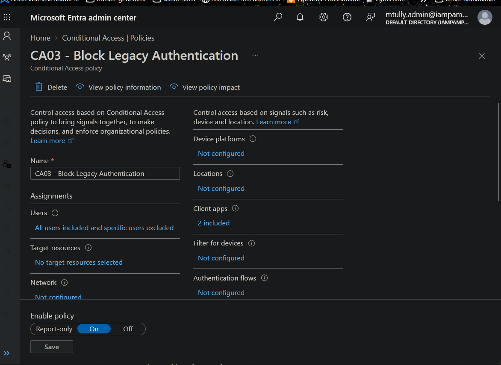

*04-1: Policy overview showing "No target resources selected" with Enable policy set to On.*

### Why this is a problem

Conditional Access evaluates assignments in order. If a sign-in doesn't match the policy's target resources, Entra stops evaluating that policy and records it as **Not Applied**, without ever checking the client app condition. With no target resources, CA03 could never match any sign-in. A legacy-protocol sign-in to Exchange Online would have passed through CA03 untouched.

The policy's metadata shows it was created and last modified on the morning of 2026-08-31, with no changes afterward. This was not drift. The policy was misconfigured from the day it was built. The policy list's **State: On** column reports whether a policy is enabled, not whether it does anything.

### Missed during the original build

The original build on 2026-08-31 was documented, and that evidence already showed the defect. It was not recognized at the time.

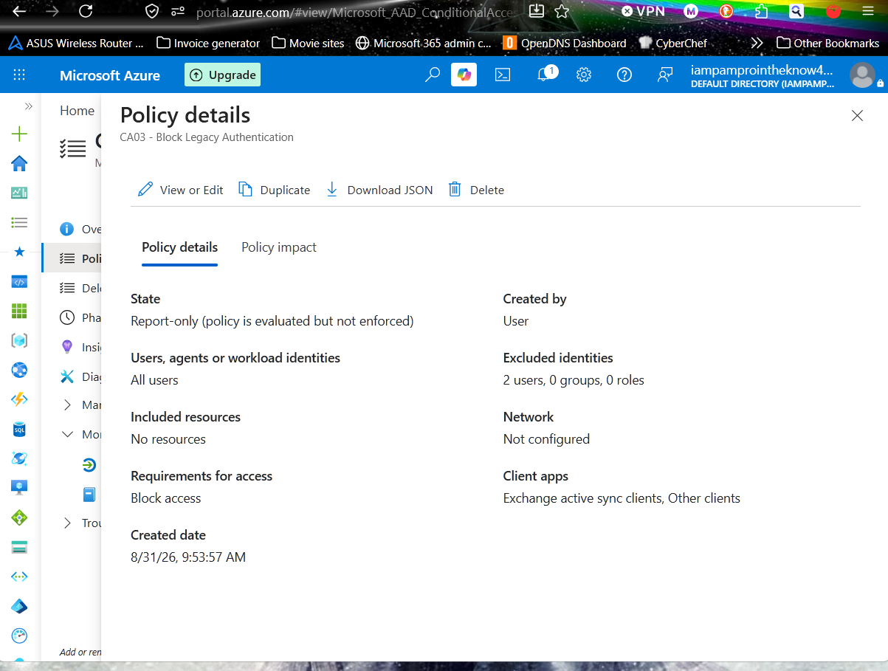

*aug-01: Captured at creation on 8/31/26, while CA03 was still in Report-only. "Included resources: No resources" is already visible. The screenshot was taken to verify exclusions, and the resources line was not checked.*

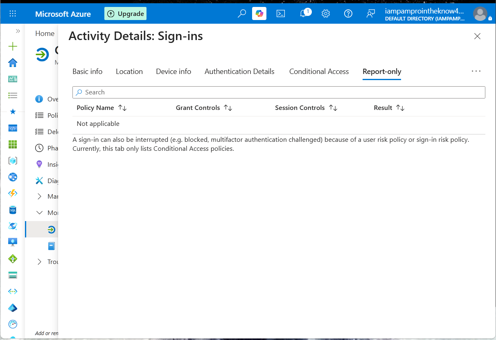

*aug-04: The August Report-only test. CA03 does not appear on the sign-in's Report-only tab ("Not applicable"). At the time this was read as "no legacy authentication detected." It was actually the symptom: a policy with no target resources is never evaluated, so it doesn't appear in the results at all.*

The policy was then switched to On (aug-05). Both signals were there on day one. The test was run, but its result was read as a pass when it was a failure.

### How it was confirmed in the logs

A sign-in by `mtully.admin` at 5:38 PM, before the fix, was opened in the Sign-in logs:

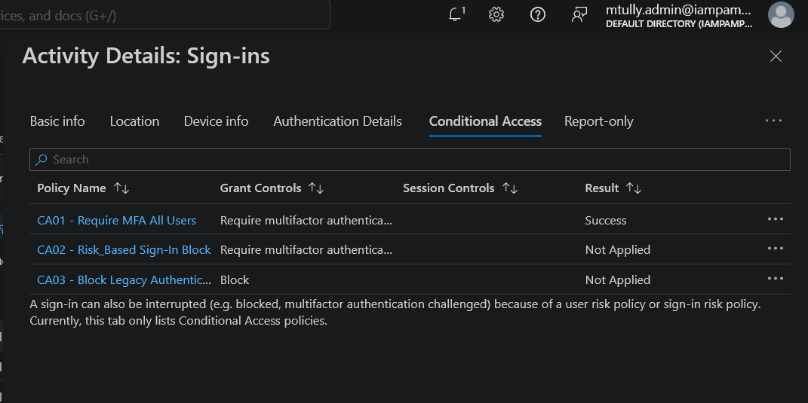

*06-0: Pre-fix sign-in. CA01 applied successfully (MFA satisfied); CA03 shows Not Applied.*

"Not Applied" on its own doesn't prove the defect, because a correctly configured CA03 would also skip a browser sign-in. The per-policy evaluation detail shows *why* it was skipped:

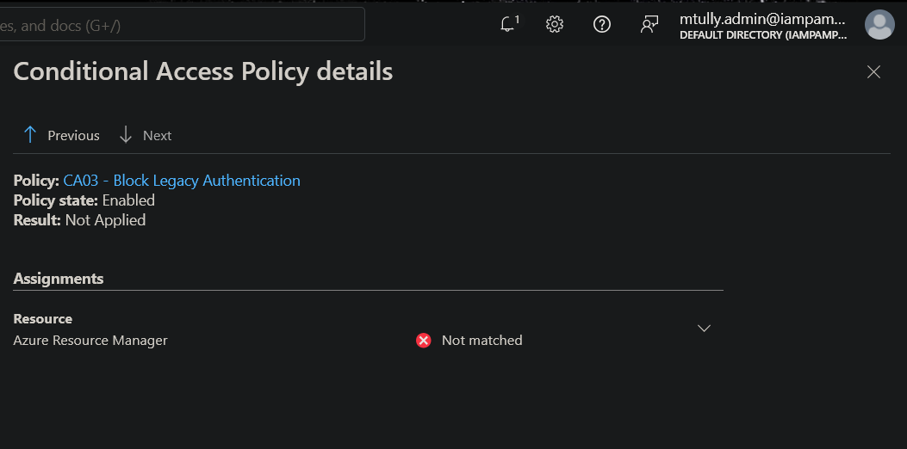

*06-0b: **Finding, log evidence.** Policy state Enabled, Resource (Azure Resource Manager) **Not matched**. Evaluation stopped at the resource check and never reached the client app condition.*

### Resolution

1. **Target resources** was changed to **All resources (formerly 'All cloud apps')**.
2. **Enable policy** was changed from On to **Report-only** in the same edit, so the corrected scope could be observed before it enforced anything. Both changes were saved together at 6:05 PM, so the policy never ran as "On + All resources" without an observation step.
3. Entra's "Don't lock yourself out" prompt was acknowledged with **I understand**. The signed-in administrator was **not** excluded, consistent with the earlier finding *Standing Administrator Account Excluded from CA MFA & Risk-Based Policies*.

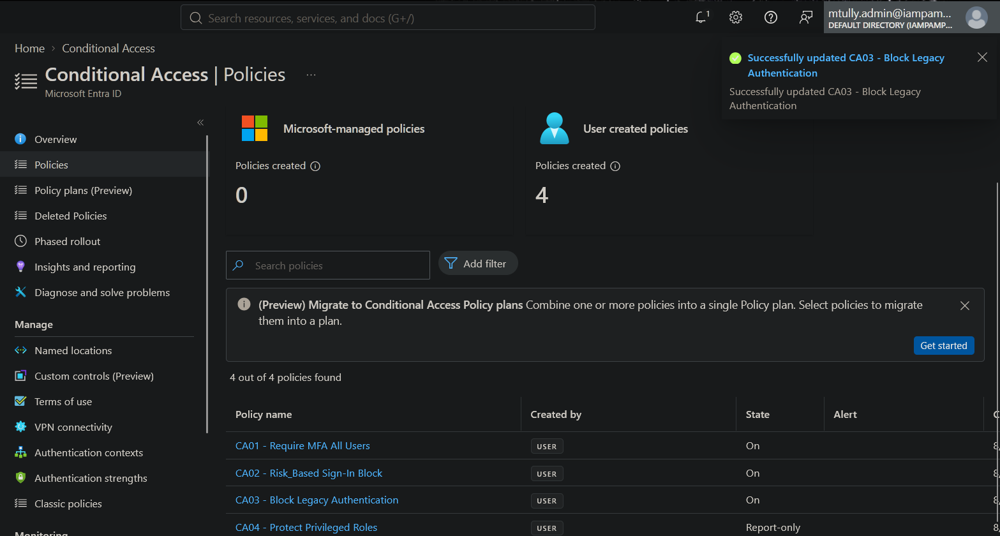

*05-1: Portal confirms CA03 was successfully updated. (The list had not refreshed yet and still shows On.)*

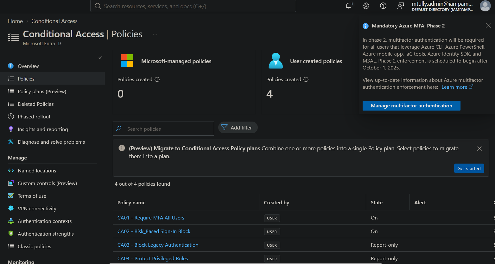

*05-2: After refresh, CA03 shows Report-only.*

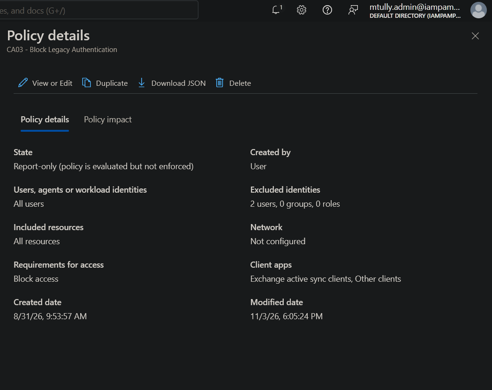

*05-3: **Fix.** Included resources now reads "All resources"; state is Report-only. Modified 11/3/26 6:05 PM.*

### Verification

A fresh interactive sign-in by `mtully.admin` at 6:20 PM, after the fix, was opened in the Sign-in logs, and its Report-only tab was checked:

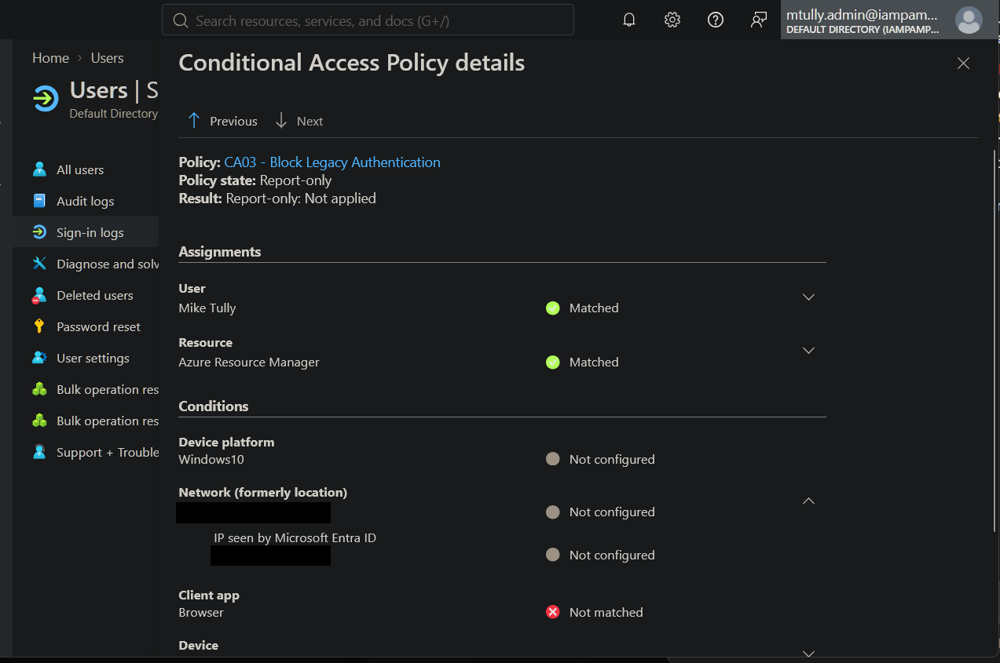

*06-1: **Verification.** User Matched, Resource Matched, Client app (Browser) Not matched. The policy now evaluates fully and skips this sign-in only because it uses modern authentication. A legacy client would match and be blocked. (Source IP and location redacted.)*

Comparing 06-0b and 06-1 shows the change in evaluation path. Before the fix, CA03 stopped at the resource check. After it, CA03 passes the user and resource checks and makes its decision on the client app condition, which is how the policy was designed to work.

With the fix verified, CA03 was returned to **On**:

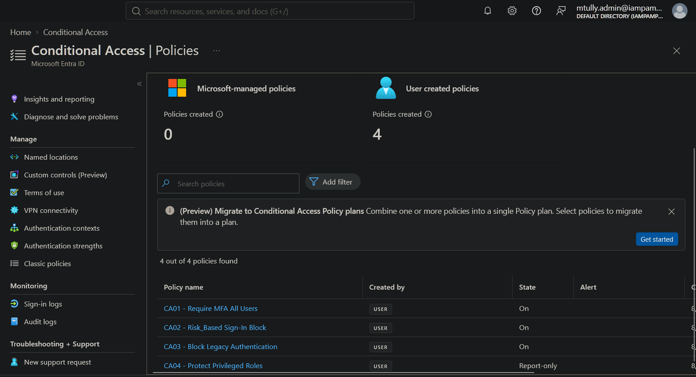

*07-1: CA03 enforced (On) with the corrected scope.*

---

## 4. Risk Rating & Justification

**Rating:** High

**Justification:** Unblocked legacy authentication is one of the most common initial-access paths in Microsoft 365 environments, because those protocols can't perform MFA and are routinely targeted by automated password spray. For 64 days, the control meant to close that path was disabled in practice while reporting itself as enabled. The false "On" status raises the severity: a missing control is usually noticed, but one that appears active gives administrators and auditors false confidence and stops anyone from looking further.

The rating is High rather than Critical for three reasons:

1. This is a lab tenant with no production mailboxes or real users.
2. No legacy-authentication sign-ins were observed during the review. (Absence in this review is not proof of absence over the full window.)
3. `CA01 - Require MFA All Users` may have partly compensated, since a legacy client can't satisfy an MFA grant. Whether CA01's client-app scope covers legacy clients is a follow-up item (see Analyst Notes), so this compensation is not counted as confirmed.

In a production tenant with live Exchange Online mailboxes, the same finding would be rated High at minimum.

**Likelihood:** Medium. It requires a valid or guessable password plus a legacy-protocol client, which attackers routinely automate.
**Impact:** High. It allows a tenant-wide MFA bypass for any in-scope account, including privileged accounts.

---

## 5. Business Impact

- **Security risk:** Any account with a weak or reused password could have been accessed through IMAP, POP, SMTP AUTH or ActiveSync without MFA, bypassing the tenant's primary identity protection.
- **Audit and compliance risk:** A control reported as enabled but not operating is a control-effectiveness failure. In a SOX ITGC or ISO 27001 audit, "configured but not operating" is treated as a deficiency, and evidence based only on the "On" status would have overstated the tenant's security posture.
- **Operational risk:** Reports and dashboards that rely on policy state alone, including this lab's own README, which listed CA03 as a completed control, would have repeated the false assurance.

---

## 6. Compliance Mapping

| Framework | Control | Description |
|---|---|---|
| NIST 800-53 | IA-2 | Identification and Authentication (MFA could be bypassed through legacy protocols) |
| NIST 800-53 | CM-6 | Configuration Settings (control deployed with a defective setting) |
| NIST 800-53 | CA-7 | Continuous Monitoring (control effectiveness was not verified after deployment) |
| CIS Controls v8 | CIS 4 | Secure Configuration of Enterprise Assets and Software |
| CIS Controls v8 | CIS 6 | Access Control Management |
| ISO 27001:2022 | A.8.9 | Configuration management |
| ISO 27001:2022 | A.5.15 | Access control |
| SOX ITGC | Logical Access Controls | Control design existed but was not operating effectively |

---

## 7. Remediation Steps

1. In **Entra admin center → Conditional Access → Policies → CA03**, set **Target resources → Include → All resources**.
2. In the same edit, set **Enable policy → Report-only**, then **Save**. Do not exclude the signed-in administrator when prompted.
3. Generate a fresh interactive sign-in. Open it in **Sign-in logs → Report-only tab → CA03 → policy details**, and confirm **Resource: Matched**. For a browser sign-in, **Client app: Not matched** is the expected result.
4. Set **Enable policy → On** and save. Confirm CA03 shows **On** in the policy list.
5. **Scope check:** audit every other Conditional Access policy for the same defect. Open **View policy information** and confirm "Included resources" is not "No resources." *(Completed 2026-11-03: CA01 and CA02 both target All resources.)*
6. **Preventive control:** add "verify against a live sign-in log entry" to the definition of done for every Conditional Access policy. A policy is not complete until at least one sign-in shows it evaluated past the resource check. The **State** column alone is not evidence that a policy works.

---

## 8. Evidence

All screenshots are in this folder.

| File | Shows |
|---|---|
| `00-1_ca_policy_inventory.png` | Policy inventory before the audit; CA03 reports On |
| `01-1_users_include_all_users.png` | Users: Include = All users |
| `01-2_users_exclude_tab.png` | Users: Exclude = specific users |
| `01-3_FINDING_target_resources_none.png` | **Finding:** Target resources = None |
| `01-4_users_excluded_breakglass_only.png` | Exclusions limited to the two break-glass accounts |
| `02-1_client_apps_legacy_only.png` | Client apps = Exchange ActiveSync + Other clients |
| `03-1_policy_details_block_access_no_resources.png` | Summary: Block access, No resources, created and modified 8/31/26 |
| `04-1_policy_overview_state_on.png` | Overview: no target resources, Enable policy = On |
| `05-1_save_confirmation.png` | Fix saved |
| `05-2_policy_list_ca03_report_only.png` | CA03 in Report-only after the fix |
| `05-3_policy_details_all_resources_report_only.png` | **Fix:** Included resources = All resources |
| `06-0_signin_1738_ca_tab_ca03_not_applied.png` | Pre-fix sign-in: CA03 Not Applied |
| `06-0b_FINDING_signin_1738_resource_not_matched.png` | **Finding, log evidence:** Resource Not matched |
| `06-1_signin_1820_resource_matched_clientapp_not_matched_REDACTED.png` | **Verification:** Resource Matched, Client app Not matched |
| `07-1_ca03_enforced_on.png` | CA03 returned to On |

**Original build evidence (2026-08-31),** in [`2026-08-31_original_build/`](./2026-08-31_original_build/):

| File | Shows |
|---|---|
| `aug-01_policy_details_no_resources_at_creation.png` | **Defect visible at creation:** Included resources = No resources |
| `aug-02_client_apps_legacy_selected.png` | Client apps configured for legacy clients |
| `aug-03_grant_block_access.png` | Grant set to Block access |
| `aug-04_reportonly_signin_ca03_not_listed.png` | **Misread test:** CA03 absent from Report-only results |
| `aug-05_enabled_confirmation.png` | CA03 switched to On |
| `aug-06_policy_list_three_policies.png` | Policy list at the time (CA01 to CA03) |

---

## 9. Remediation Status

| Status | Date | Notes |
|---|---|---|
| Introduced | 2026-08-31 | Policy created without target resources; defect visible in build screenshot aug-01 but not recognized |
| Identified | 2026-11-03 | Found during a tab-by-tab configuration audit of existing CA policies |
| Reported | 2026-11-03 | Self-identified during the lab audit; documented in this report |
| Remediated | 2026-11-03 | Target resources set to All resources; staged in Report-only at 6:05 PM |
| Verified | 2026-11-03 | 6:20 PM sign-in shows Resource Matched; policy returned to On |

---

## 10. Analyst Notes

The most important lesson here is not the missing setting. It's that the August test produced the right evidence and was misread. A Report-only check where the policy *doesn't appear at all* is a failed test, not a clean one. A correctly scoped policy shows up on every in-scope sign-in, as **Report-only: Not applied** for modern-auth traffic. "Not applicable" with the policy missing from the list means it never ran. This is now a standing rule for every remaining module: a test only passes if the policy appears in the evaluation results.

This is also the second Lab 02 finding where a Conditional Access policy looked right at a glance and wasn't. The first was a standing admin exclusion on CA01 and CA02. The lesson is the same both times: the portal's status indicators show what a policy is *set to*, not what it *does*. The only reliable evidence that a Conditional Access policy works is a sign-in log entry showing it evaluated as intended.

The most useful tool here was the **per-policy evaluation detail** in the sign-in logs, opened from the "..." on a policy row. The top-level "Not Applied" result looked the same before and after the fix, because a browser sign-in is skipped either way. Only the detail view showed the difference: stopped at Resource before the fix, decided on Client app after it. Testing should go down to that level, not stop at the summary.

**Context for this audit:** the review happened after resolving two prerequisite issues. The tenant's P2 trial had expired, which locked Conditional Access. And the tenant's original Global Administrator was an external consumer (Gmail-based) Microsoft account that the Microsoft 365 admin center wouldn't accept, so licensing couldn't be restored through it. A native cloud admin account (`mtully.admin`) was created, and an Entra ID P1 trial was activated with recurring billing disabled.

**Open follow-up:** the CA01 and CA02 policy summaries both show **Client apps: 1 included**. The August documentation for CA01 recorded the client apps condition as Not Configured. That difference should be checked in Module 06 (Testing/Validation). If either policy is limited to browser sign-ins only, MFA and risk-based blocking would not cover desktop, mobile or PowerShell sign-ins.

---

*Report generated as part of IAM/PAM lab work. Environment is a controlled lab simulation (Entra ID P1 trial tenant), not a production system.*
