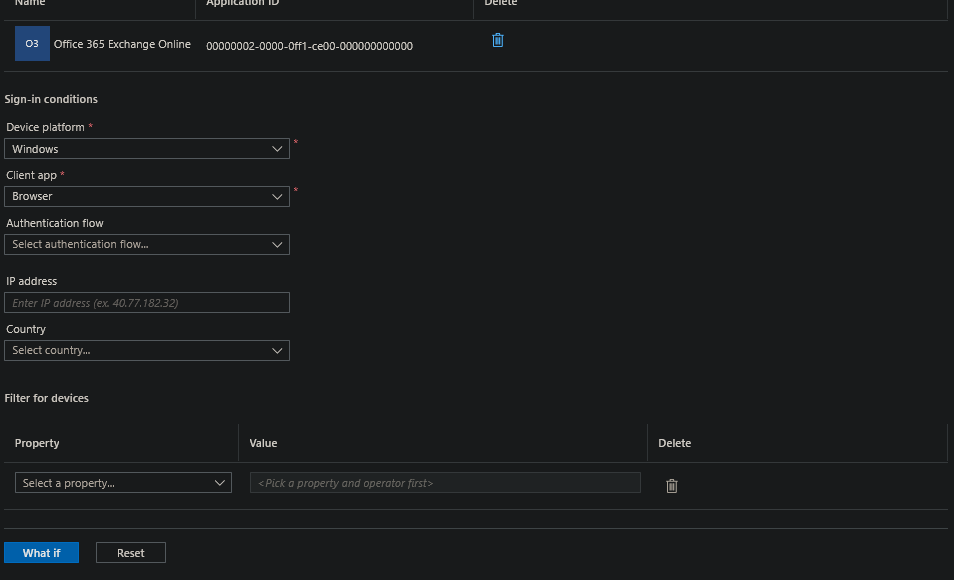
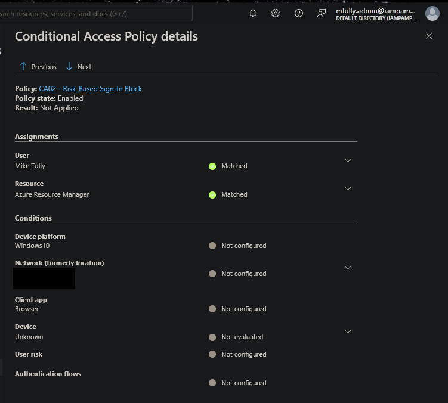

# Risk-Based Sign-In Policy Inactive After Entra ID P2 License Lapse

## 1. Executive Summary

A security rule designed to react to suspicious sign-ins, such as logins from known-malicious IP addresses or impossible travel, stopped working when the tenant's premium license expired. The rule still displays as "On," and nothing on the policy warns that it can no longer act. The problem was found during cross-policy testing, when the testing tool offered no way to simulate a risky sign-in and the sign-in logs showed the rule had no risk data to evaluate. The tenant's universal MFA policy limits the practical exposure. The broader lesson is that a security control can be switched off by a licensing change without anyone touching the control itself.

---

## 2. Finding Details

| Field | Value |
|---|---|
| **Finding Title** | Risk-Based Sign-In Policy Inactive After Entra ID P2 License Lapse |
| **Finding Type** | Policy Gap |
| **Date Identified** | 2026-11-04 |
| **Environment / Tool** | Microsoft Entra ID, Conditional Access, Microsoft Entra ID Protection (tenant: iampamprointheknow42gmail.onmicrosoft.com) |
| **Risk Rating** | Medium |
| **Affected System(s)** | CA02 - Risk_Based Sign-In Block |
| **Affected Account(s)** | All users in scope of CA02 (all users except the two break-glass accounts) |
| **Root Cause** | Entra ID P2 trial ended; tenant now licensed at Entra ID P1 |

---

## 3. Technical Description

### Background

`CA02 - Risk_Based Sign-In Block` was built and validated in August 2026 while the tenant had an Entra ID P2 trial. It includes all users, excludes both break-glass accounts, targets all resources, and has one condition, **sign-in risk = High**, with the grant control **Require multifactor authentication**.

Sign-in risk scores are produced by Microsoft Entra ID Protection, which is a P2 feature. Microsoft's documentation states: *"Organizations with Microsoft Entra ID P2 licenses can create Conditional Access policies incorporating Microsoft Entra ID Protection sign-in risk detections."*

The P2 trial later expired. On 2026-11-03 the tenant was relicensed with an Entra ID P1 trial to restore Conditional Access.

### How it was discovered

Module 06 used the Conditional Access **What If** tool to simulate each policy. The planned test for CA02 set sign-in risk to High for a standard user and confirmed that CA02 applies. **The What If form had no sign-in risk or user risk field**, because those fields only appear in tenants licensed for ID Protection.

*03-0b: What If sign-in conditions. Device platform, client app, authentication flow, IP address, country and device filters are offered. Sign-in risk is not.*

### Confirmation in the sign-in logs

The per-policy evaluation detail for CA02 on a real administrator sign-in (2026-11-04) was opened to see how the policy is evaluated now:

*04-1: CA02 state Enabled, User Matched, Resource Matched, Result Not Applied. The Conditions list shows device platform, network, client app, device, user risk and authentication flows, with **no sign-in risk row at all**. (Source IP and location redacted.)*

CA02 passes both assignment checks and is then Not Applied, yet its only condition, sign-in risk, doesn't appear in the evaluation. Without ID Protection there is no risk level to evaluate, so the policy cannot reach a state where it applies.

### Why this is a problem

- **Silent failure:** the policy list, policy details and enable toggle all still show CA02 as On. Nothing in the policy surfaces the license dependency.
- **The control depends on something outside it:** CA02's configuration was never changed. A billing event disabled it.
- **Same pattern as Finding 3 (CA03):** a second policy in this lab reported On while protecting nothing, from a different cause. Checking the status column is not enough to confirm a policy works.

### Additional design observations (independent of licensing)

These were noted during the review and would apply even with P2 restored:

1. **Name and grant don't match.** The policy is named "Risk_Based Sign-In *Block*," but its grant control is Require MFA, not Block access. Anyone reading the policy list would assume risky sign-ins are blocked.
2. **Overlap with CA01.** CA01 already requires MFA for all users on all sign-ins. A high-risk sign-in from a session that already completed MFA satisfies CA02's grant without a new challenge. Microsoft's recommended risk-based policy pairs Require MFA (or a stronger authentication strength) with **sign-in frequency: Every time**, which forces fresh authentication on each risky sign-in.

---

## 4. Risk Rating & Justification

**Rating:** Medium

**Justification:** Risk-based sign-in policies are a key defense against password spray, token replay from anonymous infrastructure, and impossible-travel sign-ins. Losing this control silently is a real gap. The rating is Medium rather than High for three reasons:

1. **Compensating control:** CA01 requires MFA for every user on every sign-in. Because CA02's grant was also Require MFA, losing it did not remove the MFA requirement. It removed only the extra *risk-triggered* response, which per observation 2 was already limited.
2. **Lab tenant:** there are no production users or data.
3. **Evidence exists:** CA02 was validated while P2 was active (Module 5 evidence, August 2026). The gap is limited to the period after the license lapsed.

In a production tenant where the risk policy's grant was **Block access** and no universal MFA policy existed, the same license lapse would be rated **High**.

**Likelihood:** Medium. License lapses, downgrades and unassigned licenses happen routinely during renewals and cost reviews.
**Impact:** Medium. In this tenant, impact is limited by CA01; it would be higher without that compensating control.

---

## 5. Business Impact

- **Security risk:** risky sign-ins (anonymous IP, malware-linked IP, impossible travel, leaked credentials) receive no additional response beyond the baseline MFA requirement.
- **Audit and compliance risk:** a control documented as operating is not operating. A control inventory based on policy state would overstate the tenant's posture.
- **Financial and governance risk:** licensing decisions such as non-renewal, downgrades or reduced seat counts can disable security controls with no change ticket and no review by the security team.

---

## 6. Compliance Mapping

| Framework | Control | Description |
|---|---|---|
| NIST 800-53 | SI-4 | System Monitoring (risk-based detection no longer acted on) |
| NIST 800-53 | CA-7 | Continuous Monitoring (control effectiveness not re-verified after licensing change) |
| NIST 800-53 | CM-3 | Configuration Change Control (licensing change affected a security control outside change control) |
| CIS Controls v8 | CIS 6 | Access Control Management |
| ISO 27001:2022 | A.5.15 | Access control |
| ISO 27001:2022 | A.8.9 | Configuration management |
| SOX ITGC | Logical Access Controls | Control documented as operating but not operating effectively |

---

## 7. Remediation Steps

1. **Restore the license dependency:** assign Entra ID P2 (or a suite that includes it, such as Microsoft 365 E5 or EMS E5) to all users in CA02's scope. *Decision for this lab: not restored. CA02 was validated with P2 in August, and the finding itself is the deliverable. Documented as a known inactive control.*
2. **Re-validate after licensing returns:** use What If with sign-in risk = High to confirm CA02 applies, then check a sign-in log entry for a sign-in risk row.
3. **Fix the grant/name mismatch:** either change the grant to **Block access** to match the name, or rename the policy (for example, "CA02 - Risk-Based Sign-In MFA") to match its behavior.
4. **Strengthen the risk response:** add session control **Sign-in frequency: Every time** so a high-risk sign-in forces fresh MFA instead of reusing an existing session.
5. **Preventive control:** add "Conditional Access policies that depend on P2 features" to the license renewal and downgrade checklist, and re-run What If tests after any licensing change.

---

## 8. Evidence

All screenshots are in this folder.

| File | Shows |
|---|---|
| `03-0b_test3_inputs_conditions_browser.png` | What If sign-in conditions: no sign-in risk field available |
| `04-1_ca02_eval_detail_1104_REDACTED.png` | CA02 evaluation detail: no sign-in risk row; Not Applied after User and Resource matched |

Original CA02 build and validation with P2 active (August 2026) is in `../05_risk_based_signin_policy/`.

---

## 9. Remediation Status

| Status | Date | Notes |
|---|---|---|
| Introduced | After Aug 2026 | Entra ID P2 trial ended; tenant later relicensed at P1 |
| Identified | 2026-11-04 | Module 06 What If testing; confirmed in sign-in log evaluation detail |
| Reported | 2026-11-04 | Documented in this report and the Lab 02 README (Finding 4) |
| Remediated | Not remediated | Accepted for the lab: P2 not restored; design recommendations documented |
| Verified | N/A | Re-validation steps listed in Section 7 for when P2 is available |

---

## 10. Analyst Notes

This finding came from a test that *couldn't run*, and the inability to run it was the evidence. The plan called for a What If simulation of a high-risk sign-in. When the risk field wasn't on the form, the easy path was to skip that test and move on. Asking *why* the field was missing led to the licensing dependency.

Lab 02 has now found two policies that showed On while protecting nothing: CA03 because of a missing setting, and CA02 because of a missing license. Both would pass a review that only checks the policy list. Both were caught by testing what the policy actually *does* to a sign-in.

---

*Report generated as part of IAM/PAM lab work. Environment is a controlled lab simulation (Entra ID P1 trial tenant), not a production system.*
