# Finding 5: Retired Personal Global Admin Account Still Active and Signing In

**Severity: HIGH** | **Status: Remediated 2026-11-05** | **Lab 02, Module 07**

## 1. Executive Summary

A review of 30 days of sign-in logs found that the original administrator account for this tenant, a personal Gmail-based Microsoft account, is still active and still holds full administrator rights. That account was replaced by a dedicated cloud admin account on November 3, 2026, but it was never shut off, and it signed into the Azure portal successfully the same evening. Today the only thing protecting it is multifactor authentication. If its password and second factor were ever compromised, an attacker would have full control of the tenant through an account nobody is watching. The same day it was found, the account's admin role was removed and the account was disabled. The lasting fix is to make retiring the old account a required step whenever an admin account is replaced.

## 2. Finding Details

| Field | Value |
|---|---|
| **Finding Title** | Retired personal Global Admin account still active and signing in |
| **Finding Type** | Orphaned/Dormant Account; Privileged Account Misuse |
| **Date Identified** | 2026-11-05 |
| **Environment / Tool** | Microsoft Entra ID (P1 trial), sign-in logs (portal JSON export) |
| **Risk Rating** | High |
| **Affected System(s)** | Tenant `iampamprointheknow42gmail.onmicrosoft.com` |
| **Affected Account(s)** | `iampamprointheknow42_gmail.com#EXT#@iampamprointheknow42gmail.onmicrosoft.com` (display name "Mike Tully") |

## 3. Technical Description

### What was observed

The tenant was created on 2026-07-13 with a personal Microsoft account (Gmail). That account was made Global Administrator and used for all admin work through Lab 01 and the early Lab 02 modules. On 2026-11-03 a native cloud admin, `mtully.admin@iampamprointheknow42gmail.onmicrosoft.com`, was created to replace it, because the Microsoft 365 admin center rejects the personal account. The personal account was never disabled or stripped of its role.

The sign-in logs show it remained usable after it was replaced:

| Time (UTC) | Event | Result |
|---|---|---|
| 2026-11-03 21:07:42 | Azure portal sign-in | Interrupted. CA01 required MFA, not completed (07-2a) |
| 2026-11-03 21:14:52 | Azure portal sign-in (same session, correlation ID `01a1a33d...`) | Interrupted. CA01 required MFA, not completed (07-2b) |
| 2026-11-03 21:15:28 | Azure portal sign-in | **Success** with MFA. CA04 result `reportOnlySuccess` |
| 2026-11-03 21:15 to 21:34 | 30 non-interactive token sign-ins (Azure portal, Entra admin UX, Security Copilot API, password reset service) | Success |
| 2026-11-05 21:43:39 | Azure portal sign-in | Failed, error 50126 (wrong password). Analyst picked the wrong account by mistake. CA not evaluated |

### Why this proves the account still has admin rights

CA04 (Protect Privileged Roles) is scoped only to members of the Global Administrator, Privileged Role Administrator and Security Administrator roles. On 2026-11-03 at 21:15:28, CA04 evaluated this account and returned `reportOnlySuccess`. CA04 was still in Report-only mode at that time. A CA04 match is only possible if the account held one of those three roles. A standard user such as Alyssa Morgan returns `notApplied` for CA04 in the same dataset.

### Secondary issue: duplicate display name

Both admin accounts use the display name **"Mike Tully."** In the sign-in log detail views (07-2a/b/c), the User field shows only the display name, so the retired account and the active admin look identical. An analyst has to open each event and compare the UPN or object ID to tell which admin acted. That slows down incident review and weakens accountability.

### How it was discovered

1. Entra admin center → Sign-in logs, filtered by Conditional access = Failure, last 1 month (07-1).
2. Per-policy evaluation detail opened on each failure (07-2a, 07-2b, 07-2c).
3. Full 30-day export (Download → JSON, interactive and non-interactive), parsed in Python and summarized in `Lab02_CA_Policy_Matrix.xlsx`.

```python
# Filter used to isolate the retired account (external identity, B2B collaboration flow)
retired = [r for r in signins if r["crossTenantAccessType"] == "b2bCollaboration"]
# -> 31 sign-ins, all 2026-11-03 21:15-21:34 UTC, all MFA, 1 interactive success
```

### What protected the tenant

CA01 (Require MFA All Users) applied to every one of this account's sign-ins, and CA04 now enforces MFA plus a 4-hour sign-in frequency on it. So the controls worked. The problem is that the account should not exist in a usable state at all.

## 4. Risk Rating & Justification

**Rating:** High

**Justification:** The account has the highest privilege level in the tenant, and nobody uses it or monitors it anymore. Its owner considers it retired, so unusual activity on it is unlikely to be noticed. It is a consumer Microsoft account, so its password, recovery options and security settings are managed outside the tenant, where the organization's policies don't apply. MFA through CA01 and CA04 is the only remaining barrier. A single compromise of that personal account, for example through a phished consumer password, an MFA-fatigue attack or a SIM swap on recovery, would mean full tenant takeover. The rating is not Critical because MFA is currently enforced and no misuse was observed.

**Likelihood:** Medium. It requires compromising a personal account that is protected by MFA.
**Impact:** High. Full Global Admin control of the tenant.

## 5. Business Impact

- **Operational:** An attacker with Global Admin can disable Conditional Access, create backdoor admins, delete users and lock out legitimate administrators, including through the break-glass accounts.
- **Compliance:** Retaining privileged access for an identity that is no longer in use fails standard access-review and account-lifecycle requirements (SOX ITGC logical access, NIST AC-2). An auditor would cite it.
- **Accountability:** Two admin identities with the same display name make it harder to prove who performed a privileged action during an investigation.

## 6. Compliance Mapping

| Framework | Control | Description |
|---|---|---|
| NIST 800-53 | AC-2 / AC-2(3) | Account Management; disable accounts that are no longer required |
| NIST 800-53 | AC-6(5) | Least Privilege: restrict privileged accounts to the minimum number needed |
| NIST 800-53 | IA-2(1) | MFA for privileged accounts (control currently satisfied by CA01/CA04) |
| NIST 800-53 | AU-6 | Audit record review: this finding was surfaced through log review |
| CIS Controls v8 | 5.3 | Disable dormant accounts |
| CIS Controls v8 | 5.4 | Restrict admin privileges to dedicated admin accounts |
| ISO 27001:2022 | A.5.18 / A.8.2 | Access rights; privileged access rights |
| SOX | ITGC | Logical access: removal of access no longer required |

## 7. Remediation Steps

1. **Confirm the replacement admin works first.** Sign in as `mtully.admin` in a Firefox private window and confirm Global Administrator is listed under Entra ID → Users → mtully.admin → Assigned roles. Confirm that both break-glass accounts still hold Global Admin. Never remove the last working admin.
2. **Remove the role.** Entra ID → Users → Mike Tully (`iampamprointheknow42_gmail.com#EXT#...`) → Assigned roles → select Global Administrator → Remove assignment. Repeat for any other admin roles listed.
3. **Block sign-in.** On the same user → Overview toolbar → Block sign-in → Yes. This is reversible and keeps the account and its history for evidence.
4. **Revoke existing sessions.** On the same user → Revoke sessions, so any existing tokens stop working immediately.
5. **Rename for clarity.** Change the display name to "Mike Tully (RETIRED personal)" and the active admin's display name to "Mike Tully (Admin)", so the two are distinguishable in logs.
6. **Validate.** Attempt one sign-in to the Azure portal with the retired account. Expected result: error 50057 (user account is disabled). Screenshot the failed sign-in from Sign-in logs, then confirm that Assigned roles shows none.
7. **Prevent recurrence.** Add to the admin-account runbook: whenever an admin account is replaced, retiring the old one (remove roles, block sign-in, revoke sessions) is part of the same change. Review the Global Administrator role membership monthly (Entra ID → Roles and administrators → Global Administrator), or with an Access Review once on P2.

### Remediation performed (2026-11-05)

Steps 1-4 were completed as `mtully.admin`. The tenant's current UI has no "Block sign-in" toolbar button, so sign-in was blocked through **Edit properties → Settings → uncheck "Account enabled"**. Step 5 (renaming) is deferred. A live sign-in test (Step 6) was not run. Instead, the fix was verified on the account itself: Assigned roles = 0 and Account status = Disabled (07-4d). A disabled account is refused at authentication (error 50057) before any password or MFA check.

The duplicate display name caused a real near-miss during remediation. The Assigned roles page shows only "Mike Tully," so the account had to be confirmed by its UPN (`#EXT#`) on the Overview page before the role was removed (07-4a, 07-4b). Removing the role from the wrong "Mike Tully" would have stripped Global Admin from the working admin account.

## 8. Evidence

**07-1:** Sign-in logs, Conditional access = Failure, last month. Three failures, all 2026-11-03.

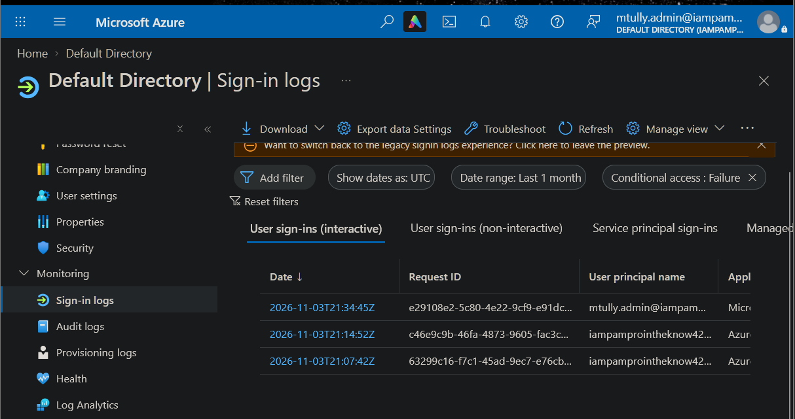

**07-2a / 07-2b:** Retired account, 21:07:42 and 21:14:52. Same correlation ID. CA01 matched, result Failure, status Interrupted (MFA required).

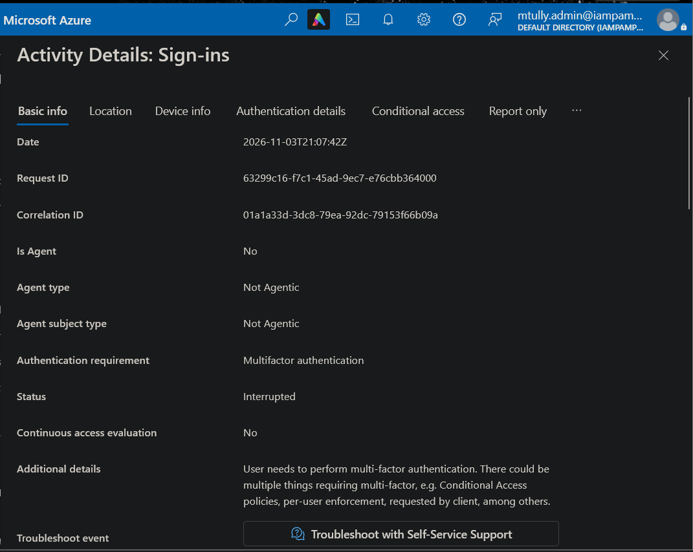
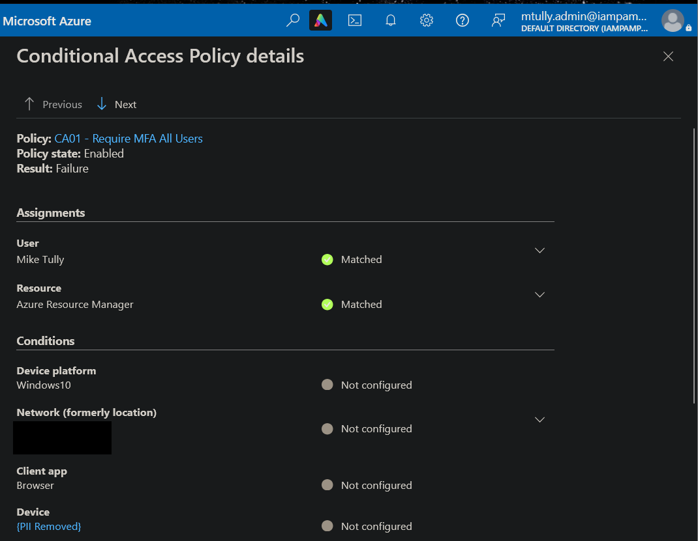
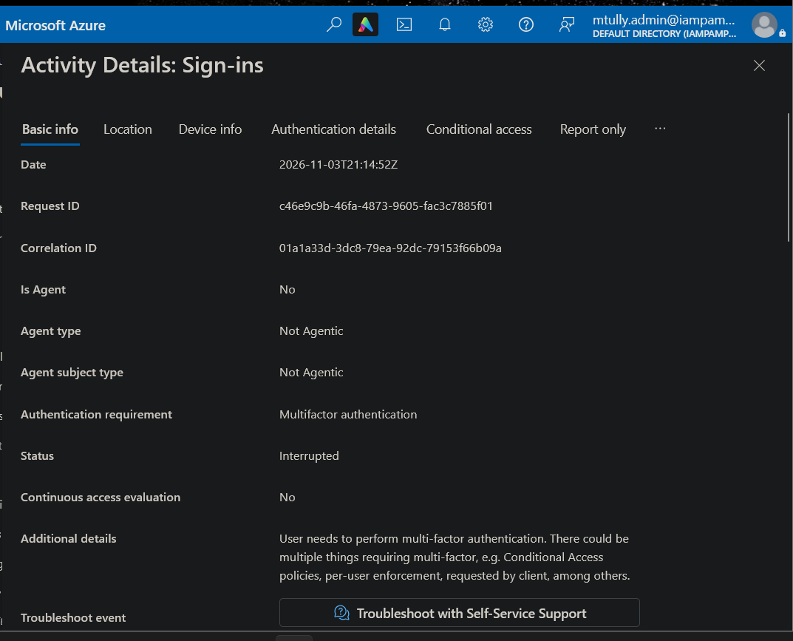
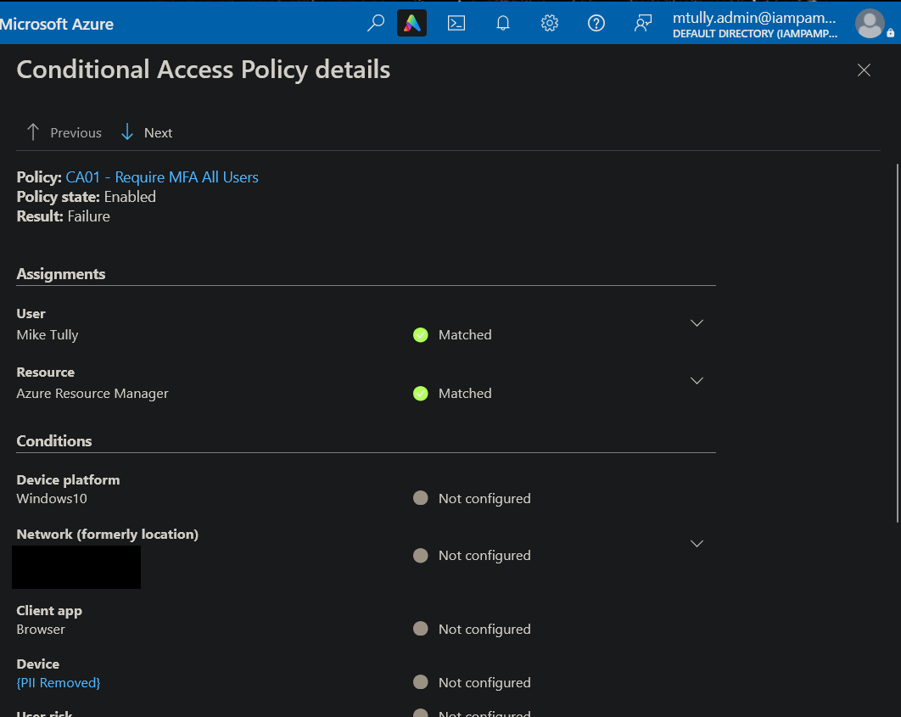

**07-2c:** Active admin `mtully.admin`, 21:34:45. First sign-in, sent to MFA registration. This shows the display name "Mike Tully" is identical to the retired account's.

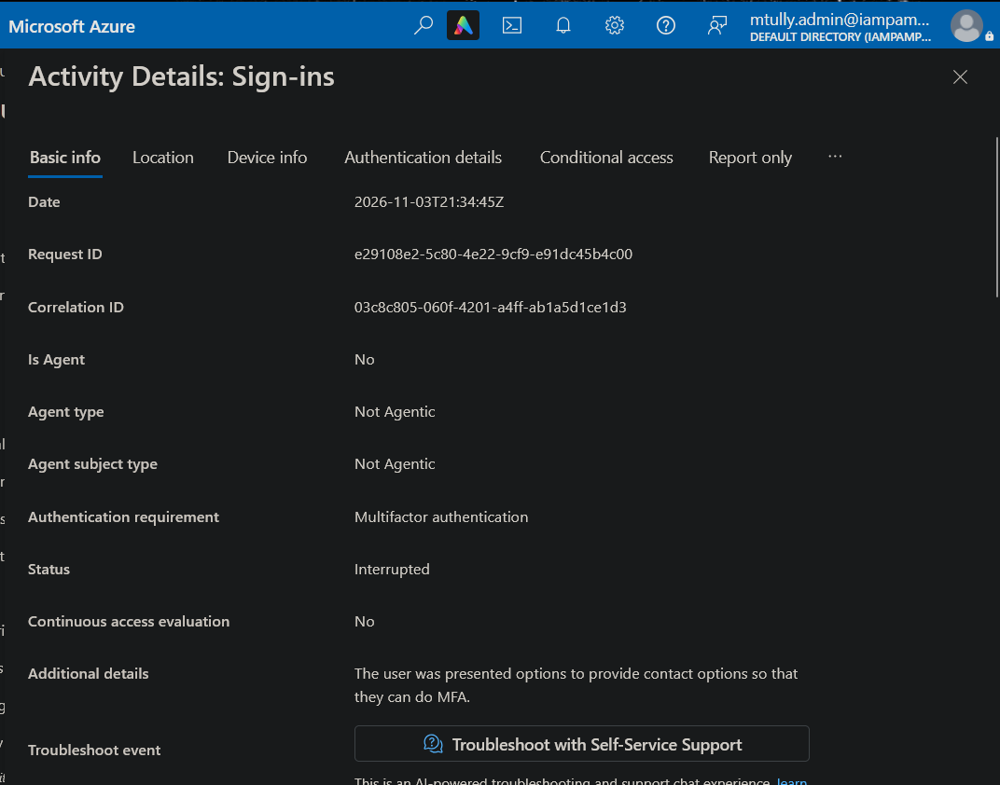
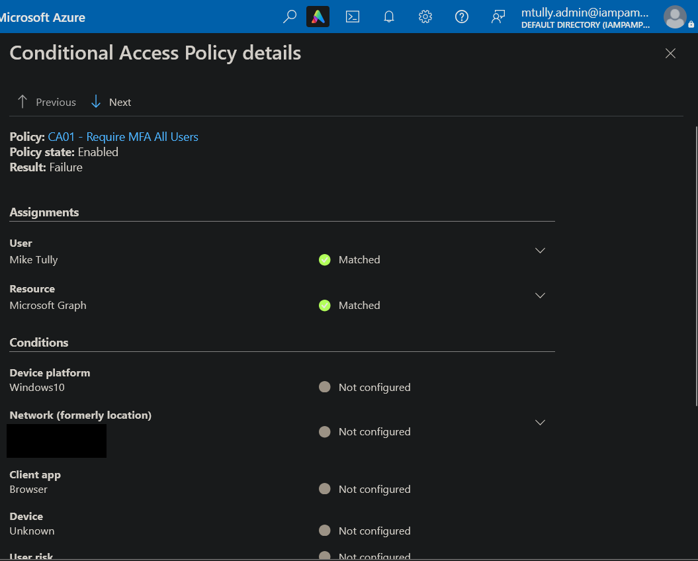

**07-4a / 07-4b (before):** Retired account holds Global Administrator (Direct, Organization scope). Overview shows the `#EXT#` UPN, Assigned roles 1, Account status Enabled.

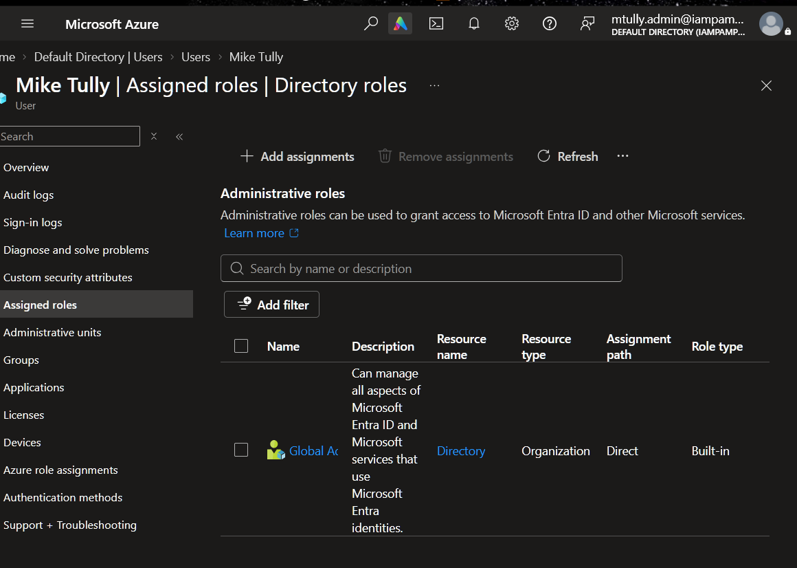
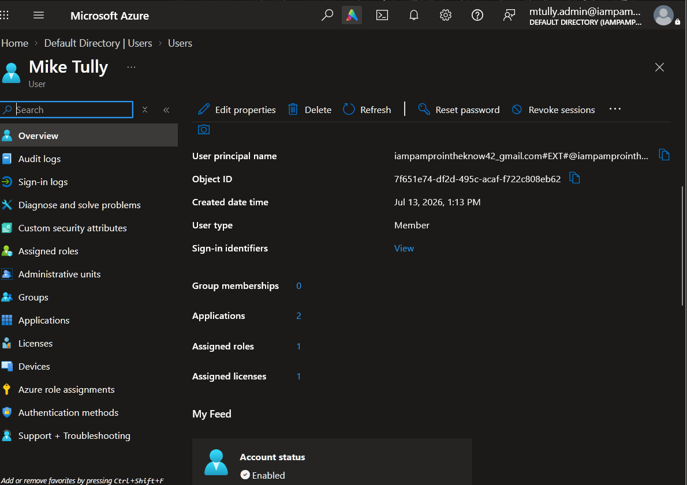

**07-4c / 07-4d (after):** Assigned roles 0. Account status Disabled.

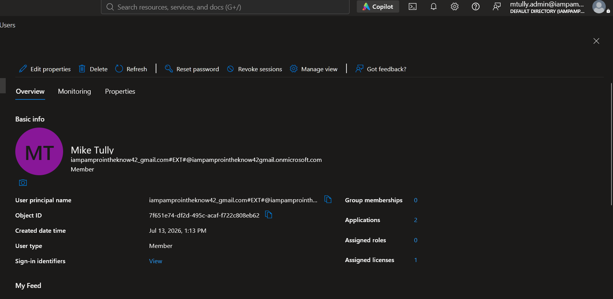
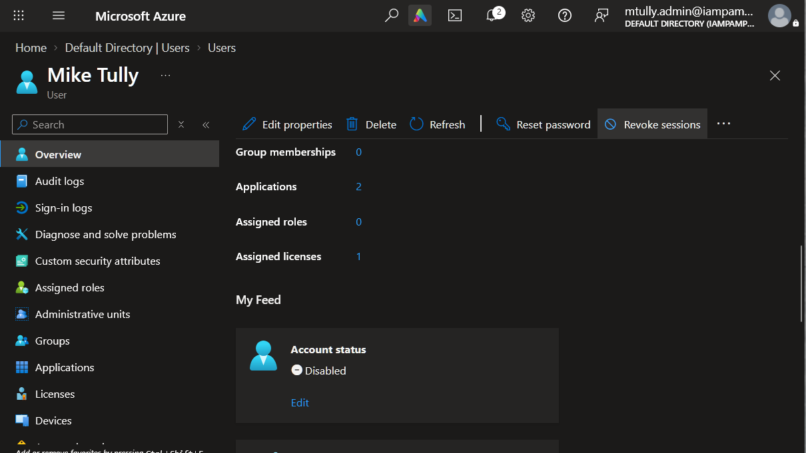

**Log excerpt** (from the JSON export, IP and location removed):

```
createdDateTime        : 2026-11-03T21:15:28Z
userDisplayName        : Mike Tully
crossTenantAccessType  : b2bCollaboration
appDisplayName         : Azure Portal
status.errorCode       : 0
authenticationRequirement : multiFactorAuthentication
CA01 - Require MFA All Users      : success
CA04 - Protect Privileged Roles   : reportOnlySuccess
```

**Workbook:** `../Lab02_CA_Policy_Matrix.xlsx`, tab SignIn_Data, filter Account = "Original personal admin (Gmail)".

## 9. Remediation Status

| Status | Date | Notes |
|---|---|---|
| Identified | 2026-11-05 | Module 07 sign-in log review |
| Reported | 2026-11-05 | This report |
| Remediated | 2026-11-05 | Global Admin removed, account disabled, sessions revoked (Steps 1-4). Rename (Step 5) deferred |
| Verified | 2026-11-05 | Account page shows Assigned roles 0, Account status Disabled (07-4c, 07-4d) |

## 10. Analyst Notes

This finding came out of the logs, not out of a checklist. I replaced my admin account on Nov 3 and treated the old one as gone, but the logs showed it signing in successfully twenty minutes later. That's the same pattern as Finding 3, where a policy looked "On" in the portal but the evaluation data showed otherwise. In both cases, what I assumed about the configuration and what the evaluation data showed didn't match, and the evaluation data was right.

Two data limitations, stated plainly:

- **No "before" data for CA03.** There were no lab sign-ins between 2026-10-05 and 2026-11-03, so the logs cannot show CA03 before and after its Nov 3 fix. All 507 sign-ins in the export used a browser or modern client, so CA03 never had legacy traffic to block. Its effectiveness rests on the Module 06 What If test, not on logs.
- **Export gap.** The three Nov 3 "Interrupted" sign-ins shown in 07-1 do not appear in the portal JSON download. The screenshots are the evidence for those three events.

I mistakenly signed in with the retired account on 2026-11-05 (wrong password, error 50126). That was my error, not an attack. I kept it in the record because it shows the account still accepts sign-in attempts.

---

*Report generated as part of IAM/PAM lab work. Environment is a controlled lab simulation.*
